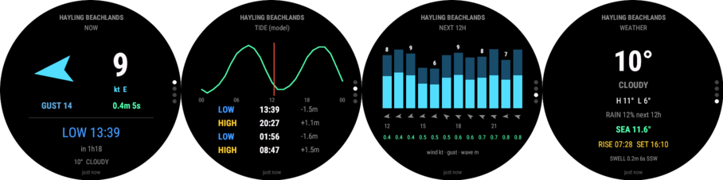
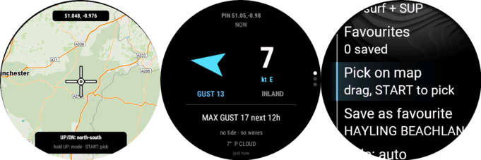

# Tideline

Wind, tides, waves and weather for surfing, paddleboarding and canals, on a
Garmin **fēnix 8** watch. UK coast and inland waterways.




*Screenshots from the Connect IQ simulator (fēnix 8 47mm, live data for Hayling Island).*

**➡ [How to install it on your watch](INSTALL.md)**: download one file and drag it onto the watch. About 5 minutes, Windows or Mac.

## What it shows

| Screen | |
|---|---|
| **NOW** | Wind arrow, speed and direction, gusts, wave height and period, next high/low tide and how long until it |
| **TIDE** | Today's tide curve with a "now" line, plus the next highs and lows |
| **NEXT 12H** | Hourly wind (solid) and gust (dark) bars, wind arrows, wave heights |
| **WEATHER** | Temperature, high/low, rain chance, sea temperature, sunrise/sunset, swell |
| **Glance** | Wind, next tide and wave height, in the glance list |

**Picking a place** (press START): *Here (GPS)*, *Nearby spots* (56 UK surf and
SUP spots), *Favourites*, or *Pick on map*. The map works with buttons only,
so it works with wet hands and touch turned off. UP/DOWN moves the target,
holding UP switches between north-south, east-west and zoom, and START picks.

**Canals and lakes:** if there's no sea within 14 km, Tideline switches to
inland mode: wind, gusts and weather, no tide or waves. For a canal right next
to a tidal harbour, use *Tide: OFF here* in the START menu.

## No server, no account

The watch fetches everything itself through Garmin Connect on your phone:

- **Wind and weather:** [Open-Meteo](https://open-meteo.com) forecast API (free, no key)
- **Waves, swell, sea temperature and tides:** [Open-Meteo Marine](https://open-meteo.com/en/docs/marine-weather-api).
  High and low tides are worked out from the modelled sea level. Against
  Admiralty predictions for Portsmouth they're usually within about 10 minutes,
  but can be up to ~30 minutes out at places with double high tides (the Solent).
- **Optional exact port tide times:** paste a free [UKHO Admiralty UK Tidal API](https://admiraltyapi.portal.azure-api.net/)
  key ("Discovery" tier) into the app settings. Tideline then uses the nearest
  official tide station.

**Not for navigation.** Modelled data can be wrong. Check official sources before going out.

## Install

**Step-by-step guide: [INSTALL.md](INSTALL.md)** (Windows and Mac, no technical knowledge needed).

Short version: download `Tideline.prg` from the [latest release](../../releases/latest), plug the watch in,
copy the file into `GARMIN/Apps`, unplug.

The `.prg` is built for the **fēnix 8 47mm / 51mm AMOLED**. For other fēnix 8 models, build your own
(below). A Connect IQ Store listing is on the way. It will add automatic updates and phone settings
(wind units, UKHO key). A USB-installed copy uses knots.

## Build it yourself

You need the [Connect IQ SDK](https://developer.garmin.com/connect-iq/sdk/) (9.x) and a developer key.

```sh
CIQ=~/opt/connectiq TIDELINE_KEY=~/developer_key.der ./build.sh            # fenix847mm .prg
CIQ=~/opt/connectiq TIDELINE_KEY=~/developer_key.der ./build.sh fenix843mm # another model
./build.sh export                                                           # Store .iq
```

`sim/` runs the simulator headless in Docker (Ubuntu 22.04, because newer distros lack
webkit2gtk-4.0). That's how the screenshots above were made.

`preview/` is a browser version of the screens using the same data logic
(`tide.js` matches `app/source/Data.mc` step for step). Serve the folder and open
`index.html` to try any location on a map without a watch.

## Licence

MIT. Weather and marine data © [Open-Meteo](https://open-meteo.com), CC BY 4.0.
Tide data, when a key is set, © Crown copyright, UK Hydrographic Office.
